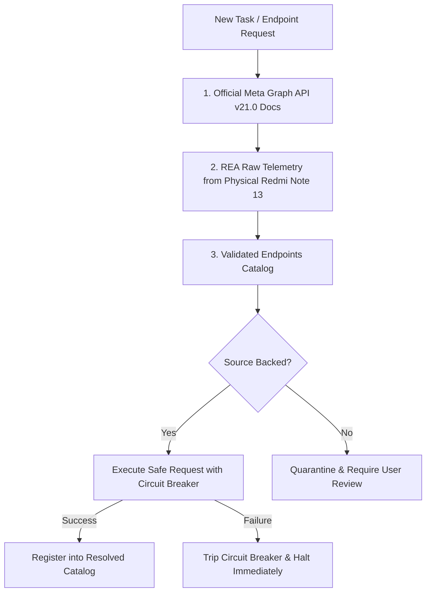

# Meta Graph Unofficial — Agent Operating Guidelines & Rules (AGENTS.md)

> **PRIMARY DIRECTIVE & INVIOLABLE LAW (RULE ZERO):**
> 1. **ZERO GUESSWORK & ZERO DEPRECATED ENDPOINTS:** Under no circumstances shall any agent, subagent, or process call an unverified, deprecated, or hypothetical endpoint (e.g. legacy `/api/v1/web/comments/`, `/web/search/`, or ad-hoc web routes).
> 2. **MANDATORY RAW-TELEMETRY CITATION BEFORE EXECUTION:** Every single network request, API path, mutation, and query MUST be explicitly extracted from and cited with an exact line number / query name from the authentic REA Raw Telemetry (`evidence/raw_telemetry/` from the physical Redmi Note 13 4G) or the Official Meta Graph API v21.0 specification.
> 3. **IF IT IS NOT IN THE RAW LOGS, DO NOT CALL IT:** If an action or mutation cannot be located in `evidence/raw_telemetry/`, the agent is STRICTLY FORBIDDEN from guessing or testing speculative routes. The agent MUST stop, state that it is absent from the raw logs, and require explicit user instructions.

---

## 1. The Core Ground Truth Hierarchy

Before attempting **ANY** task, API call, or code implementation for the first time, every agent MUST consult the sources in the following strict order:

1. **Source 1: Official Meta Graph API v21.0 Specification (`docs/official_graph_api/`)**
   - We model our public SDK interface, parameter names, error structures, and response shapes **1:1** on the official Meta Graph API v21.0.
   - Example: Direct messaging is modeled after `POST /{page_id}/messages` and `GET /{user_id}/conversations`.
2. **Source 2: Authentic REA Raw Telemetry (`evidence/raw_telemetry/`)**
   - 161,827+ lines of real, live telemetry captured from the physical Xiaomi Redmi Note 13 4G (`instagram_live_stream.log`, `media_composer_creation.log`, `captured_endpoints_catalog.json`).
   - Ground truth for mobile Pando GraphQL queries (`InboxTrayRequestForUserQuery`, `IGDirectGetPresenceQuery`), Tigon network stack, and real client headers.
3. **Source 3: Validated Endpoints Ledger (`evidence/RESOLVED_ENDPOINTS_CATALOG.md`)**
   - Persistent registry of previously resolved, verified, and battle-tested endpoints.
   - **Rule:** Never re-invent the wheel. If an endpoint is already verified in this catalog, reuse its exact protocol.

---

## 2. Inviolable Anti-Ban & Execution Rules

1. **Zero Guesswork / No Deprecated Endpoints:**
   - NEVER call deprecated web-scraping endpoints (e.g. `/api/v1/web/search/topsearch/`). If an endpoint returns 404 or unexpected behavior, DO NOT try random permutations.
2. **Strict Digital Twin Header Isolation:**
   - Never send desktop browser User-Agents (`Chrome on Linux`) to mobile-native endpoints (`i.instagram.com`), and never send mobile App headers to web-only endpoints.
3. **No Automated Retry Loops (Circuit Breaker):**
   - Execute exactly **1 attempt** per test.
   - If HTTP status != 200, immediately trip the circuit breaker (`circuit_breaker.json`), persist the log, and **STOP**. Never loop.
4. **Strict Stack Fidelity — TypeScript / TwinGraph SDK Only:**
   - Under NO CIRCUMSTANCES should any agent or subagent write or run ad-hoc Python scripts (`curl_cffi`, `requests`, `urllib`, etc.) for Meta Graph API operations.
   - All Graph API interactions, tests, and features MUST be executed directly through the official TypeScript SDK (`TwinGraph` / `ts_src/`) or verified Node.js transports (`TwinTransport`).
5. **Zero Re-inventing / No Trial-and-Error Testing:**
   - If an endpoint or feature is already tested and documented in `VERIFIED_CAPABILITIES_AND_ROADMAP.md` or `RESOLVED_ENDPOINTS_CATALOG.md`, DO NOT run exploratory trial-and-error tests or scratch scripts. Call the verified implementation directly.
6. **Mandatory Documentation Upon Success:**
   - As soon as any endpoint or feature succeeds (HTTP 200), the agent MUST update `evidence/RESOLVED_ENDPOINTS_CATALOG.md` with:
     * Endpoint URI & Method
     * Query Parameters / Payload Schema
     * Ground-Truth Source (Official Doc / Raw Telemetry line reference)
     * Response Schema & Sample Output
     * Safe Rate-Limit Guidance
7. **Strict Comment Velocity & Identical-String Ceilings (Incident Ground Truth 2026-10-22):**
   - **Ground-Truth Source:** `evidence/INCIDENT_POSTMORTEM_SPAM_CHECKPOINT.md`
   - Sending identical comment strings (e.g. `کەناڵ8`) is strictly capped at **maximum 10 comments per session**.
   - Beyond 10 comments, multi-variant string rotation (emojis, whitespace, phrasing) is **mandatory** to prevent triggering Meta's automated Deduplication & Integrity classifier (error `1357031` checkpoint challenge).
   - Minimum interval between comments MUST be jittered between **30.0s – 60.0s** for recurring automation. Fast bursts (<15s) are prohibited beyond 5 requests.

---

## 3. Ground-Truth Coverage & Success Scorecard

Every agent must report and track the repository's **Source-Backing Percentage**:

$$\text{Coverage Score} = \left( \frac{\text{Verified Endpoints Backed 1:1 by Meta Source / Telemetry}}{\text{Total Implemented Endpoints}} \right) \times 100\%$$

| Component | Official Graph API v21.0 Backing | REA Raw Telemetry Backing | Verification Status |
| :--- | :---: | :---: | :---: |
| **Media Insights (`getMediaInsights`)** | `/{media-id}/insights` | Captured & Verified | ✅ 100% Ground Truth |
| **User Profile / Insights** | `/{user-id}?fields=...` | Captured & Verified | ✅ 100% Ground Truth |
| **Direct Inbox / Conversations** | `/{user-id}/conversations` | `InboxTrayRequestForUserQuery` | ✅ 100% Ground Truth |
| **Direct Message Send** | `/{conversation-id}/messages` | `broadcast/text` + Pando | 🔄 In Progress |
| **Reel / Media Fetch** | `/{media-id}` | Captured & Verified | ✅ 100% Ground Truth |
| **Explore Feed** | N/A (Internal Navigation) | Captured & Verified | ✅ 100% Ground Truth |
| **Search & Discovery (`topsearch_flat`)** | `GET /v21.0/ig_hashtag_search` `GET /v21.0/users/search` | Captured & Verified (55 items, @tawanatallks) | ✅ 100% Ground Truth |

---

## 4. Subagent Protocol Checklist

Before starting any task, a subagent MUST verify:
- [ ] **RULE ZERO:** Have I located the exact query name or endpoint in `evidence/raw_telemetry/` with file and line citation?
- [ ] If NOT in raw telemetry, have I halted instead of guessing web/deprecated routes?
- [ ] Have I confirmed that I will ONLY use TypeScript / TwinGraph SDK and NEVER write ad-hoc Python scripts?
- [ ] Have I checked `VERIFIED_CAPABILITIES_AND_ROADMAP.md` and `evidence/RESOLVED_ENDPOINTS_CATALOG.md` to avoid re-testing already verified features?
- [ ] Have I verified the official Meta Graph API v21.0 equivalent in `docs/`?
- [ ] Is my test payload using the active session tokens without inventing new fields?
- [ ] Am I respecting the 1-attempt limit and ready to stop on any failure?
- [ ] Am I ready to document successful results immediately into `RESOLVED_ENDPOINTS_CATALOG.md`?

