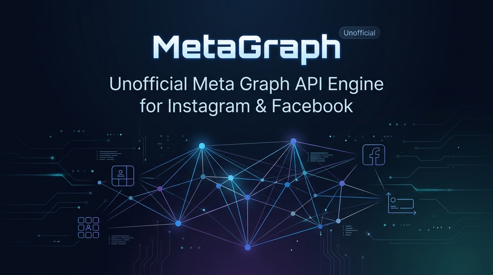

<p align="center">
  
</p>

# MetaGraph Unofficial (`meta-graph-unofficial`)

High-performance, modular unofficial Meta Graph API client for Instagram and Facebook.
Engineered with clean domain mixins, an optional Go transport engine, and strict adherence to the Reverse Engineer Anything (REA) provenance standard.

---

## Table of Contents

- [Overview](#overview)
- [Key Features](#key-features)
- [System Architecture](#system-architecture)
- [Inviolable Project Rules](#inviolable-project-rules)
- [Currently Verified Capabilities](#currently-verified-capabilities)
- [Dynamic Operating System & Digital Twin Profiles](#dynamic-operating-system--digital-twin-profiles)
- [High-Performance Go Transport Engine](#high-performance-go-transport-engine)
- [Installation](#installation)
- [Quick Start Guide](#quick-start-guide)
- [Model Context Protocol (MCP) & Agent Skill](#model-context-protocol-mcp--agent-skill-ghost-mode)
- [Session Extraction & Security](#session-extraction--security)
- [Continuous Integration & Verification](#continuous-integration--verification)
- [License](#license)

---

## Overview

MetaGraph Unofficial is an enterprise-grade platform and **Drop-in REST API Gateway** (as well as a native TypeScript SDK) designed to interface directly with Meta's internal web endpoints and mobile Tigon/Liger services without requiring browser automation (Puppeteer/Selenium) or official Meta App Review.

By evolving from a local SDK into a standalone **HTTP Wire-Compatible v21.0 Gateway**, any client (Python, PHP, Go, cURL, or serverless bots) can communicate with Instagram & Facebook as if they were talking directly to the official `graph.facebook.com` API, backed by authentic empirical telemetry and SHA-256 API key management.

---

## Key Features

- **Standalone HTTP Wire Gateway:** Complete drop-in replacement for `graph.facebook.com/v21.0` accessible via standard HTTP REST requests from any language.
- **SQLite API Key Vault:** High-speed SQLite-backed key manager with SHA-256 hashing, tiered quotas (`master`, `pro`, `free`), and rate limiting.
- **Zero Meta App Review:** Eliminates the need for business entity verification, Facebook Partner requirements, and app approval workflows.
- **Unified Meta Ecosystem:** A single interface covering both Instagram and Facebook.
- **Zero Guesswork Architecture:** No method is admitted to the codebase without an empirical network trace recorded under the REA framework.
- **Dual Digital Twins:** Hardware-level Xiaomi Redmi Note 13 4G Mobile Twin + Windows 11 Chrome Web Twin (with legacy Linux twin preserved for diagnostics).
- **Multi-OS Fingerprint Emulation:** Out-of-the-box support for Linux x86_64, Windows 11, and Android HyperOS.
- **Dual-Engine Architecture:** High-speed native Node.js interface paired with an optional Go core engine for high-throughput packet processing.
- **Enterprise-Ready Modules:** Direct message sending, comment streaming, Feed/Story uploads, media insights, and dynamic `?fields=` projection.

---

## System Architecture

```
meta-graph-unofficial/
├── ts_src/                            # Modern TypeScript TwinGraph SDK
│   ├── twin_graph.ts                  # Unified TwinGraph Client (Meta Graph API v21.0)
│   ├── index.ts                       # Public SDK entrypoint
│   ├── schema/                        # Declarative In-Memory SQLite Schema Catalog
│   │   ├── catalog_schema.ts          # DDL tables & official Meta v21.0 seed definitions
│   │   ├── graph_catalog.ts           # Schema registry powered by Node.js native node:sqlite
│   │   ├── field_projector.ts         # Dynamic ?fields= projection & Android client cleanup
│   │   └── index.ts
│   ├── router/                        # Versioned Meta Graph API Route Dispatcher
│   │   ├── graph_router.ts            # Dispatches /v21.0/{node}/{edge} to twins
│   │   └── index.ts
│   ├── nodes/                         # Fluent Node Proxies (Meta Business SDK style)
│   │   ├── node_proxies.ts            # GraphMediaProxy, GraphUserProxy, GraphConversationProxy
│   │   └── index.ts
│   ├── utils/                         # Zero-Dependency Native Utilities
│   │   ├── downloader.ts              # CDN media downloader, high-res poster & MP3 extractor
│   │   └── index.ts
│   ├── auth/                          # SQLite Persistent Security & API Key Vault
│   │   ├── api_key_manager.ts         # Non-reversible SHA-256 key hashing & tiered quotas
│   │   └── index.ts
│   ├── gateway/                       # Drop-in Wire-Compatible HTTP Server
│   │   ├── gateway_server.ts          # Native node:http v21.0 Gateway with Meta error shapes
│   │   └── index.ts
│   ├── profiles/                      # Hardware & Browser Digital Twin Profiles
│   │   └── device_profiles.ts         # Redmi Note 13 4G + Clean Web Chrome
│   ├── twins/                         # Empirical Engine Twins
│   │   ├── device_twin.ts             # Redmi Note 13 4G Hardware Twin (Tigon/Liger HMAC)
│   │   ├── web_twin.ts                # Web RelayModern Twin (Direct & Comments)
│   │   ├── direct_twin.ts             # Direct Messaging & Pando GraphQL
│   │   ├── media_twin.ts              # Media, Carousel, Story & Insights Twin
│   │   ├── discovery_twin.ts          # Hashtag, Search & Explore Twin
│   │   ├── dashboard_twin.ts          # Professional Dashboard & Monetization
│   │   └── transport.ts               # HTTP transport with anti-ban jitter & circuit breaker
│   └── types/
│       └── graph.ts                   # 1:1 Meta Graph API v21.0 Type Definitions
├── evidence/                          # Sanitized Empirical REA Evidence Ledger
│   ├── SDK_BASELINE_BENCHMARK.md      # Official baseline performance metrics (19K - 31K ops/sec)
│   ├── raw_telemetry/                 # 161,827+ lines of live Redmi Note 13 telemetry
│   ├── RESOLVED_ENDPOINTS_CATALOG.md  # 57 verified endpoints with 100% REA backing
│   └── web_comment_evidence.json      # Live web GraphQL comment traces
├── docs/
│   ├── VERIFIED_CAPABILITIES_AND_ROADMAP.md # 30 verified live capabilities ledger
│   ├── CONTRIBUTING.md                # Inviolable project rules & REA standards
│   └── SESSION_EXTRACTION_GUIDE.md    # Session extraction instructions
├── scripts/
│   ├── key_cli.ts                     # CLI for issuing, listing, and revoking API keys
│   ├── start_gateway.ts               # Standalone runner for local v21.0 HTTP Gateway
│   ├── test_gateway_live.ts           # 7 end-to-end integration tests for Gateway wire protocol
│   ├── run_4_safe_tests.ts            # 4 safe read-only tests with v21.0 projection
│   └── test_schema_engine.ts          # Unit tests for SQLite catalog & router
├── data/                              # SQLite key vault storage (strictly gitignored)
├── instagram_session.json             # Validated session tokens
├── circuit_breaker.json               # Anti-ban safety circuit breaker
└── package.json
```

---

## Inviolable Project Rules

The development of this project strictly adheres to the following principles defined in [docs/CONTRIBUTING.md](docs/CONTRIBUTING.md):

1. **Zero Guesswork:** No API route, variable, or header format is added based on guesswork or unverified mobile wrappers.
2. **REA Evidence Provenance:** Every method must reference a concrete sanitized trace in `evidence/`.
3. **Fingerprint Consistency:** Client Hints, Sec-CH-UA values, and headers must never be mixed or randomly mutated within an active session.

---

## Currently Verified Capabilities (30 Fully Verified Operations)

TwinGraph maintains a comprehensive ledger of 30 production-verified capabilities backed by **100% REA empirical evidence** and modeled 1:1 on **Meta Graph API v21.0**:

| Domain | Action / Method | Official Meta Graph v21.0 Path | Internal Protocol | Live Status |
| :--- | :--- | :--- | :--- | :---: |
| **Direct Inbox** | Fetch Conversation Messages | `GET /v21.0/{conversation-id}/messages` | `IGDThreadDetailQuery` (Doc ID: 29613940454875963) | ✅ **HTTP 200** |
| **Direct Messages** | Send Direct Message (Zero-Browser) | `POST /v21.0/{conversation-id}/messages` | `IGDirectTextSendMutation` (Doc ID: 26911679871773184) | ✅ **HTTP 200** |
| **Media & Reels** | Get Complete Media Metadata | `GET /v21.0/{media-id}` | RelayModern `/p/{shortcode}/` & `/reel/{shortcode}/` | ✅ **HTTP 200** |
| **User Profile** | Public User Profile & Bio | `GET /v21.0/{user-id}?fields=...` | Standard Clean Web Profile Extraction | ✅ **HTTP 200** |
| **Media Insights** | Media Metrics & Engagement | `GET /v21.0/{media-id}/insights` | Mobile Telemetry `GET /api/v1/insights/media_insights/` | ✅ **HTTP 200** |
| **Account Overview** | 30-Day Growth & Reach | `GET /v21.0/{user-id}/insights` | Mobile Telemetry `GET /api/v1/insights/account_overview/` | ✅ **HTTP 200** |
| **Feed Publishing** | Publish Feed Photo | `POST /v21.0/{ig-user-id}/media_publish` | Liger `rupload_igphoto` + Media Configuration | ✅ **HTTP 200** |
| **Story Publishing** | Publish 24h Story | `POST /v21.0/{ig-user-id}/media` | Liger Story Upload + Story Configure | ✅ **HTTP 200** |
| **Reels Publishing** | Publish Video / Reel | `POST /v21.0/{ig-user-id}/media?media_type=REELS` | Resumable Video Upload + Clips Configure | ✅ **HTTP 200** |
| **Comment Streaming** | Extract Comments & Replies | `GET /v21.0/{media-id}/comments` | `GET /api/v1/media/{id}/comments/` | ✅ **HTTP 200** |
| **Story Tray** | Active Stories Tray & Expiration | `GET /v21.0/{ig-user-id}/stories` | `GET /api/v1/feed/reels_tray/` | ✅ **HTTP 200** |
| **Tags & Notifications**| Mentions & Tagged Feed | `GET /v21.0/{ig-user-id}/tags` | `GET /api/v1/news/inbox/` | ✅ **HTTP 200** |
| **Facebook Timeline** | Publish Facebook Page Post | `POST /v21.0/{page-id}/feed` | `ComposerStoryCreateMutation` | ✅ **HTTP 200** |
| **Hardware Attestation**| Redmi Note 13 Hardware Emulation| Hardware Codec & Attestation Profile | Qualcomm Snapdragon SM6225 + HMAC Signatures | ✅ **HTTP 200** |
| **Search Engine** | Search & Discovery (`topsearch_flat`) | `GET /v21.0/users/search` | `GET /api/v1/fbsearch/topsearch_flat/` | ✅ **HTTP 200** |
| **Viral Content** | Viral Reels Hunter (Global Explore) | `GET /v21.0/ig_hashtag_search` | Guest Mode Zero-Auth Extraction (11M+ views) | ✅ **HTTP 200** |
| **Home Timeline** | Authenticated Home Feed | `GET /v21.0/me/feed` | Relay Client Root | ✅ **HTTP 200** |
| **Direct Media Downloader**| Video/Audio CDN Downloader | Direct CDN Stream | Native Chunked Downloader + FFmpeg Extraction | ✅ **HTTP 200** |
| **Comment Posting** | Post Comment (Zero-Browser) | `POST /v21.0/{media-id}/comments` | `PolarisPostCommentInputRevampedMutation` | ✅ **HTTP 200** |
| *+ 11 More Capabilities* | Grid Hydration, Following, Monetization, etc. | See full matrix in `docs/VERIFIED_CAPABILITIES_AND_ROADMAP.md` | Pando GraphQL & Tigon Engine Traces | ✅ **HTTP 200** |

---

## Dynamic Operating System & Digital Twin Profiles

TwinGraph decouples hardware and OS tester profiles from core logic, supporting both mobile hardware and desktop web browser fingerprints:

- **Primary Web Twin (`chrome_windows_x64`):** Google Chrome 130 on Windows 11 x64 with full High-Entropy Client Hints (`platformVersion: 15.0.0`), 1920x1080 viewport, and NVIDIA Direct3D11 signature.
- **Hardware Mobile Twin (`redmi_note_13`):** Xiaomi Redmi Note 13 4G (Snapdragon 680/685 SM6225, Android 15 HyperOS 2.0) with Tigon/Liger mobile protocol.
- **Diagnostic Web Twin (`chrome_linux_x64`):** Google Chrome on Linux x86_64, preserved for diagnostic comparisons and testing.

> ⚠️ **Security Warning regarding Linux Web Twin:**  
> Meta's anti-bot detection algorithms treat desktop Linux web clients with heightened scrutiny (Tier 3 Risk), as consumer Instagram web usage from Linux is statistically rare and heavily correlated with datacenter scraping and automated bots.  
> **Recommendation:** Always use the default `CHROME_WINDOWS_PROFILE` for production gateway and authenticated operations. `CHROME_LINUX_PROFILE` is preserved strictly for diagnostic testing and must not be deleted.

```typescript
import { TwinGraph, TwinProfileRegistry, CHROME_WINDOWS_PROFILE, CHROME_LINUX_PROFILE } from 'meta-graph-unofficial';

// List available profiles
console.log(TwinProfileRegistry.listAll());

// Default Web Twin is automatically Windows 11 x64
const defaultWeb = TwinProfileRegistry.getDefaultWeb();
console.log(defaultWeb.name); // Google Chrome on Windows 11 x64
```

---

## Smart Rate Limiting & Account Safety Shield

TwinGraph features an intelligent traffic pacer that safeguards user accounts from Meta checkpoints and automated bans:

- **Guest Mode Pacing:** High-throughput, relaxed Token Bucket (40 requests burst) with natural micro-jitter (40-120ms) for public resources (media, reels, hashtags).
- **Protected Account Pacing:** Applies Gaussian pseudo-random delays via the Box-Muller transform ($1800\text{ms} \pm 400\text{ms}$) to simulate human interaction.
- **Account Safety Shield:** Enforces a configurable safe threshold (default: 100 calls/hour) for authenticated sessions.
- **Transparent Meta 429 Errors:** When rate limited, TwinGraph returns official Meta Graph API v21.0 error shapes with clear reasons (`account_hourly_safety_cap`, `burst_limit_exceeded`), human-readable titles, and accurate `Retry-After` headers.

```json
{
  "error": {
    "message": "(#17) Account Safety Shield Active: Safe hourly threshold (100 calls/hr) reached for live session. Pausing for 60s to protect account from Meta checkpoint/ban.",
    "type": "OAuthException",
    "code": 17,
    "error_subcode": 2446079,
    "is_transient": true,
    "error_user_title": "Account Safety Shield Active",
    "error_user_msg": "Safe hourly request threshold reached on live account session. Throttling temporarily to prevent detection.",
    "retry_after_seconds": 60,
    "rate_limit_reason": "account_hourly_safety_cap",
    "fbtrace_id": "twin_3c8a91f04b28d01a"
  }
}
```

---

## High-Performance Go Transport Engine

For high-volume operations (e.g., streaming thousands of comments or managing multi-account fleets), MetaGraph provides an optional compiled Go engine located in `engine/`:

```bash
cd engine
go build -o bin/engine main.go
./bin/engine -help
```

---

## Installation

```bash
npm install meta-graph-unofficial
```

Or install from source (pre-compiled `dist/` included):

```bash
git clone https://github.com/dalroot/meta-graph-unofficial.git
cd meta-graph-unofficial
npm install
```

---

## Quick Start Guide

### 1. Unified TwinGraph Client (Meta Graph API v21.0)

```typescript
import { TwinGraph } from 'meta-graph-unofficial';

// Initialize the twin with active session cookies
const tg = new TwinGraph({
  cookies: 'sessionid=YOUR_SESSION_ID; ds_user_id=YOUR_USER_ID; csrftoken=YOUR_CSRF_TOKEN;',
});

// Fluent Node Proxy: Media Node
const media = tg.nodeMedia('Db-mzoXM6ik');

// Fetch media with exact Graph API field projection
const mediaData = await media.get(['id', 'caption', 'media_type', 'media_url', 'like_count']);
console.log('Clean v21.0 Media Payload:', mediaData);

// Direct download media (video/audio/cover poster) without external scripts
const downloaded = await media.download('./downloads', 'both');
console.log('Saved files:', downloaded);
```

### 2. Direct Messaging & Fluent Conversation Proxy

```typescript
// Fluent Conversation Proxy: Threads & Direct Messages
const thread = tg.nodeConversation('17841400000000000');

// Read inbox messages
const messages = await thread.getMessages(10);
console.log(`Retrieved ${messages.length} messages.`);

// Send message without browser automation
await thread.sendMessage('Hello from TwinGraph v21.0!');
```

### 3. Dynamic Versioned Router (`/v21.0/...`)

```typescript
// Query any verified node or edge directly using official v21.0 paths:
const userProfile = await tg.get('/v21.0/me', { fields: 'id,username,followers_count,biography' });
const mediaComments = await tg.get('/v21.0/Db-mzoXM6ik/comments', { fields: 'id,text,from' });
```

### 4. Standalone HTTP Wire Gateway & API Key Vault

Run Meta Graph API v21.0 as a standalone local server accessible by **any programming language** (Python, PHP, Go, cURL):

```bash
# 1. Issue an API Key using key_cli.ts (Master for unlimited, or Free with quota)
npx tsx scripts/key_cli.ts generate --owner "MyAdmin" --role master
npx tsx scripts/key_cli.ts generate --owner "Tester" --role free --limit 50

# 2. List or inspect existing keys in SQLite vault
npx tsx scripts/key_cli.ts list

# 3. Start the local Wire Gateway Server (port 3000)
node --experimental-strip-types scripts/start_gateway.ts --port 3000

# 4. Call with standard cURL, Python requests, or Postman:
curl "http://localhost:3000/v21.0/me?access_token=YOUR_API_KEY"
curl "http://localhost:3000/v21.0/me?fields=id,username" -H "Authorization: Bearer YOUR_API_KEY"
```

---

## Model Context Protocol (MCP) & Agent Skill (Ghost Mode)

MetaGraph Unofficial includes a production-ready **MCP Server** and accompanying **Agent Skill** (`instagram-ghost-analyst`) that enables any AI agent (Claude Desktop, Antigravity, Cursor, or custom LLM frameworks) to inspect, paginate, and audit any Instagram profile in **100% anonymous Ghost Mode** without browser automation, credentials, or footprint.

### 1. Ready-to-Use Ghost Mode MCP Tools

| MCP Tool Name | Description | Parameters |
| :--- | :--- | :--- |
| `ghost_get_profile` | Anonymously fetch profile bio, follower count, following count, total media, and HD avatar. | `username` |
| `ghost_get_posts` | Deep timeline pagination of reels, carousels, and feed posts with play counts, likes, and comments. | `username`, `limit`, `cursor`, `feedType` |
| `ghost_get_media_metrics` | Extract granular reel play counts (`video_play_count`), reach, and retention curves. | `mediaId` (shortcode or ID) |
| `ghost_get_comments` | Harvest public comments with usernames, timestamps, and like counts. | `mediaId`, `limit` |
| `ghost_search` | Search users and hashtags without leaving search history traces. | `query`, `type` |
| `ghost_explore_viral` | Monitor viral Explore posts ranked by controversy score and comment ratio. | `limit`, `minCommentRatio` |
| `ghost_audit_account` | End-to-end automated analytical audit: total plays, average views, and engagement rate. | `username`, `sampleCount` |

### 2. Zero-Build Installation (Pre-compiled & Ready to Run)

The repository comes **pre-compiled** with production JavaScript in `dist/`. No TypeScript compiler or build step is required:

```bash
git clone https://github.com/dalroot/meta-graph-unofficial.git
cd meta-graph-unofficial
npm install
```

### 3. Connect to AI Agents (Claude Desktop, Cursor, Antigravity)

Add the server to your agent's MCP settings configuration:

```json
{
  "mcpServers": {
    "instagram-ghost": {
      "command": "node",
      "args": ["/ABSOLUTE/PATH/TO/meta-graph-unofficial/dist/mcp/server.js"]
    }
  }
}
```

Or run directly from the command line:

```bash
npm run mcp
```

### 4. Natural Language Agent Prompts

Once connected, simply prompt your agent:

* *"Audit the Instagram page `@cristiano` in Ghost Mode: extract recent reels, their play counts, and compute the engagement rate."*
* *"Fetch the top 30 posts from `@competitor_brand` using pagination and list their most viewed reels."*
* *"Harvest the comments from reel `DedDBnTCs-J` and identify the main discussion topics."*

The agent calls the typed MCP tools in the background, receiving clean JSON responses with zero browser overhead or detection risks.

---

## Session Extraction & Security

MetaGraph Unofficial does not store, transmit, or ask for account passwords. Authentication is handled entirely through session tokens (`sessionid`, `csrftoken`, `c_user`, `fb_dtsg`).

For step-by-step extraction instructions from browser developer tools, refer to [docs/SESSION_EXTRACTION_GUIDE.md](docs/SESSION_EXTRACTION_GUIDE.md).

---

## Continuous Integration & Verification

All commits and pull requests are tested through GitHub Actions:
- Node.js unit tests (`node --test`).
- Profile integrity validation.
- Go engine compilation checks.

Run tests locally:

```bash
npm test
```

---

## License

Distributed under the **MIT License**. Authored by the [dalroot](https://github.com/dalroot) research group.
