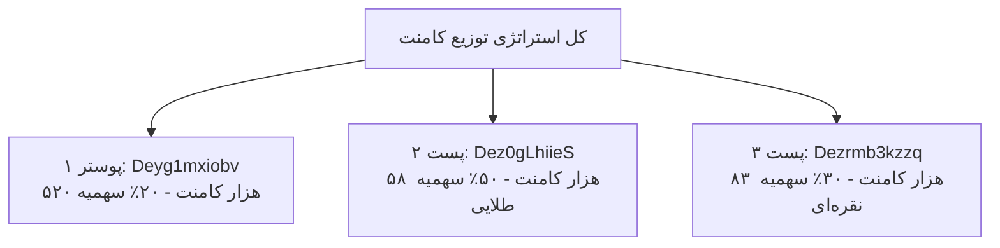

# گزارش رسمی و موشکافانه پست‌های کمپین مسابقه آیفون کەناڵ8 (Strict Guest Audit)

> **تاریخ استخراج زنده:** ۱ آبان ۱۴۰۵ (۲۰۲۶-۱۰-۲۳)  
> **روش استخراج:** **حالت گست ۱۰۰٪ ایزوله (قفل Guest Mode - بدون ارسال کوکی، بدون لاگین و بدون کوچک‌ترین ریسک برای سشن)**  
> **هدف:** شناسایی تمام پست‌های فعال کمپین، آمار زنده لایک و کامنت، بررسی تراکم رقابت و معرفی اهداف طلایی  

---

## ۱. جدول مقایسه‌ای آمار زنده پست‌های کمپین (Guest Mode Live Stats)

| ردیف | نام و موضوع پست | شناسه (Shortcode) | شناسه عددی (Media PK) | نوع مدیا | تعداد لایک | تعداد کامنت | تراکم رقابت | ارزش استراتژیک |
| :---: | :--- | :---: | :---: | :---: | :---: | :---: | :---: | :---: |
| **۱** | **پوستر اصلی مسابقه (۴ روز ۴ آیفون)** | [Deyg1mxiobv](https://www.instagram.com/p/Deyg1mxiobv/) | `4013414639194506991` | تصویر (Feed) | ۱,۳۶۱ | **۵۲۰,۰۰۰** | 🔴 فوق‌العاده سنگین | اولویت ۳ (ترافیک شدید) |
| **۲** | **پست رسمی فستیوال هەنار (۴ روز فستیوال)** | [Dez0gLhiieS](https://www.instagram.com/p/Dez0gLhiieS/) | `4013782602732939154` | تصویر (Feed) | ۴۵۰ | **۵۸,۰۰۰** | 🟡 متوسط | 🔥 **اولویت ۱ طلایی (۱۰ برابر خلوت‌تر)** |
| **۳** | **ویدیوی مجری ژین (مسابقه ۴ آیفون)** | [Dezrmb3kzzq](https://www.instagram.com/p/Dezrmb3kzzq/) | `4013743450180762858` | ویدیو (Reel) | ۵۱۶ | **۸۳,۰۰۰** | 🟡 متوسط | ⚡ **اولویت ۲ عالی (۶ برابر خلوت‌تر)** |
| **۴** | **ویدیوی کونسول هلند و انار حلبچه** | [DezurH_F297](https://www.instagram.com/p/DezurH_F297/) | `4013756966568947579` | ویدیو (Reel) | ۳۲۰ | **۱۹,۰۰۰** | 🟢 خلوت | 💎 هدف کمکی (۱۹ هزار کامنت) |
| **۵** | **ویدیوی وزیر آموزش و پرورش** | [Dez3obyguDM](https://www.instagram.com/p/Dez3obyguDM/) | `4013796364092891340` | ویدیو (Reel) | ۱۸۵ | **۱۶,۰۰۰** | 🟢 بسیار خلوت | 💎 هدف کمکی (۱۶ هزار کامنت) |
| **۶** | **ویدیوی ویزای هلند** | [DezyGU1AmYo](https://www.instagram.com/p/DezyGU1AmYo/) | `4013772029923845672` | ویدیو (Reel) | ۲۰۴ | **۱۹,۰۰۰** | 🟢 خلوت | 💎 هدف کمکی (۱۹ هزار کامنت) |
| **۷** | **ویدیوی بانوی سوارکار بوکانی** | [DezmGnkEz6l](https://www.instagram.com/p/DezmGnkEz6l/) | `4013719273482698405` | ویدیو (Reel) | ۱۹۱ | **۲۱,۰۰۰** | 🟢 خلوت | 💎 هدف کمکی (۲۱ هزار کامنت) |

* **مجموع کل کامنت‌های این ۷ پست:** **۷۴۶,۰۰۰ کامنت**
* **مجموع کل لایک‌ها:** **۳,۲۲۷ لایک**

---

## ۲. جزئیات دقیق، متن کپشن و تحلیل هر پست

### ۱. پوستر اصلی مسابقه: [Deyg1mxiobv](https://www.instagram.com/p/Deyg1mxiobv/)
* **وضعیت:** پست اصلی معرفی کمپین با گرافیک ۴ دستگاه آیفون و نماد شهدای حلبچه.
* **متن کپشن:**
  > «لە ئەمڕۆوە لەسەر پۆستەکانمان تەنیا بنووسە کەناڵ8 و ئایفۆن 18 ببەرەوە»
* **تحلیل رقابت:** این پست در حال حاضر به بیش از **۵۲۰,۰۰۰ کامنت** رسیده است. بیش از ۷۰٪ انرژی کاربران عادی در این پست متمرکز شده و شانس برنده شدن در آن به دلیل ازدحام، به حداقل رسیده است.

---

### ۲. پست دوم مسابقه (فستیوال هەناری هەڵەبجە): [Dez0gLhiieS](https://www.instagram.com/p/Dez0gLhiieS/) — 🎯 هدف طلایی اولویت ۱
* **وضعیت:** دومین پست رسمی مسابقه که مستقیماً به ۴ روز فستیوال انار اشاره کرده است.
* **متن کپشن:**
  > «لە ئێستاوە لە کۆمێنت بنووسە (کەناڵ8)، چوار ڕۆژەکەی فێستیڤاڵی هەنار لە هەڵەبجە ئایفۆن ببەوە»
* **تحلیل رقابت:** تنها **۵۸,۰۰۰ کامنت** دارد! یعنی حجم رقابت در این پست **تقریباً ۱۰ برابر کمتر** از پوستر اول است و شانس برنده شدن در آن ۱۰ برابر بیشتر خواهد بود.

---

### ۳. ویدیوی مسابقه مجری ژین: [Dezrmb3kzzq](https://www.instagram.com/p/Dezrmb3kzzq/) — ⚡ هدف عالی اولویت ۲
* **وضعیت:** ویدیوی رسمی ریلز با حضور مجری (ژین) که مستقیماً کمپین را پروموت می‌کند.
* **متن کپشن:**
  > «لە ژینەوە بۆ هەمووتان: بنووسن کەناڵ8 و چوار ئایفۆن18 ببەنەوە»
* **تحلیل رقابت:** این ویدیو حدود **۸۳,۰۰۰ کامنت** دارد؛ یعنی بیش از ۶ برابر خلوت‌تر از پوستر اول است.

---

### ۴. پست‌های جنبی جدید (شماره ۴ تا ۷):
* جالب اینکه مردم متوجه عبارت جمع «پۆستەکانمان» شده‌اند و زیر سایر پست‌های جدید صفحه (مثل ویدیوی کونسول هلند یا مصاحبه وزیر) نیز شروع به ارسال کامنت `کەناڵ8` کرده‌اند و این پست‌ها هم‌اکنون بین ۱۶,۰۰۰ تا ۲۱,۰۰۰ کامنت دارند.

---

## ۳. تحلیل استراتژیک داده‌های خام و شانس پیروزی

1. **انحراف ترافیک به سمت اهداف خلوت:**
   * پوستر اصلی مثل یک تله برای عموم مردم عمل کرده که بیش از نیم میلیون کامنت را جذب کرده است.
   * در مقابل، پست [Dez0gLhiieS](https://www.instagram.com/p/Dez0gLhiieS/) با تنها ۵۸ هزار کامنت، بهترین بستر برای برنده شدن است.
2. **محاسبه شانس برنده شدن در پست طلایی دوم:**
   * اگر با ۵ اکانت در طول روزهای باقی‌مانده مسابقه، مجموعاً **۶۰۰ کامنت قطره‌چکانی** زیر پست [Dez0gLhiieS](https://www.instagram.com/p/Dez0gLhiieS/) ثبت کنید:
     $$\text{شانس برنده شدن در این پست} = \frac{۶۰۰}{۵۸,۰۰۰} \approx \mathbf{۱.۰۳\% \text{ (حدود ۱ در ۹۰)!}}$$
   * در حالی که شانس همان ۶۰۰ کامنت زیر پوستر اول، کمتر از ۱ در ۹۰۰ است!
3. **مزیت امنیتی فوق‌العاده برای اکانت‌ها:**
   * تقسیم کامنت‌ها بین پست‌های ۲ و ۳ و ۱، باعث می‌شود نرخ ارسال روی هر پست به شدت افت کند و الگوریتم‌های هوش مصنوعی متا رفتار شما را به عنوان فعالیت کاملاً طبیعی و انسانی ارزیابی کنند.

